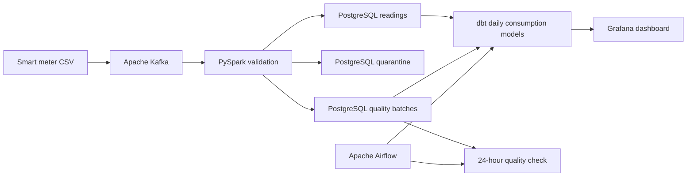

# Energy Consumption Analytics Pipeline

## Overview
Aggregate smart-meter consumption and detect unusually high readings. This is a runnable **starter project** using synthetic data, Python and SQLite.

## Business use case
Aggregate smart-meter consumption and detect unusually high readings.

## Data quality rules
The meter ID must be nonblank, and consumption must be finite and nonnegative. Readings above 30 kWh are flagged. Rows with invalid values or extra CSV fields are quarantined in `output/rejected.json` when there is at least one valid row.

## Architecture
```text
Synthetic CSV -> Python validation and transformation -> JSONL + SQLite -> SQL aggregates -> JSON report
```

## Quick start
Requires Python 3.10+. No third-party packages required. From this repository's root:

```bash
python3 -m src.pipeline
python3 -m unittest discover -s tests -v
```


Results are written to `output/`: `clean.jsonl`, `rejected.json`, `warehouse.db`, and `summary.json`.

## SQL
Open `output/warehouse.db` with any SQLite client and run `sql/analysis.sql`.

## Streaming and batch analytics

A CSV publisher simulates smart meters. PySpark validates Kafka messages and commits accepted readings, quarantined messages, and quality counters together in PostgreSQL. Airflow schedules the dbt reporting models and rolling quality checks hourly.



Use Python 3.13, Java 17, and Docker with Compose v2. Run from the project root. Spark downloads the matching Kafka connector from Maven on its first run.

```bash
python3.13 -m venv .venv
source .venv/bin/activate
python -m pip install -r requirements-stream.txt
docker compose up -d --build --wait
docker compose exec -T kafka /opt/kafka/bin/kafka-topics.sh \
  --bootstrap-server 127.0.0.1:9092 --create --if-not-exists \
  --topic energy-readings --partitions 1 --replication-factor 1
python -m src.publish_readings data/input.csv
python -m src.stream
python -m src.quality --lookback-hours 24 --max-reject-rate 0.25
```

On a fresh stack, the sample yields 3 accepted readings, 1 rejected reading for negative consumption, and 0 duplicates. The accepted reading of 42.5 kWh is flagged. Run `sql/stream_analysis.sql` against PostgreSQL for daily totals by meter.

1. Open [Airflow](http://localhost:8080) as `admin`. Get the generated password with `docker compose exec -T airflow cat /opt/airflow/simple_auth_manager_passwords.json.generated`. Trigger `energy_analytics` to run immediately, or wait for its hourly UTC schedule. [Airflow authentication documentation](https://airflow.apache.org/docs/apache-airflow/stable/core-concepts/auth-manager/simple/index.html)
2. In the Airflow run, `build_reports` runs `dbt build` to refresh the daily totals and run the model tests. `check_quality` independently evaluates rejection and duplicate rates over the past 24 hours. The sample is expected to fail `check_quality` because 25% exceeds the 10% rejection threshold. The duplicate threshold is 5%. With no data in the window, the quality task is skipped.
3. After `build_reports` succeeds, open the [Energy Consumption dashboard](http://localhost:3000/d/energy-consumption/energy-consumption) as `admin` with password `admin` by default. It shows daily totals, a per-meter breakdown, and accepted, rejected, and duplicate counts. Grafana connects through the read-only `energy_grafana` role and includes alert rules for both quality thresholds.

The host-side Python commands and Compose use `ENERGY_PG_PORT`, `ENERGY_PG_DATABASE`, `ENERGY_PG_USER`, and `ENERGY_PG_PASSWORD` if exported in your shell. The defaults are `5432`, `energy`, `energy`, and `energy-local`. `ENERGY_GRAFANA_ADMIN_PASSWORD` sets the initial dashboard login password. PostgreSQL initializes its database and the Grafana role when the volume is first created.

### Incremental processing

`python -m src.stream` processes the available backlog and exits. Add `--follow` for continuous processing or `--max-offsets` to control the number of Kafka records per microbatch. The first run starts at the earliest retained offset. Later runs resume from `output/stream/checkpoint`; running again with no new messages leaves the warehouse and quality history unchanged.

The publisher keys messages by `reading_id`. The consumer keeps the first valid record for each ID and quarantines later copies at new offsets. It ignores retries at the same Kafka topic, partition, and offset. Keep the Kafka topic, checkpoint, and PostgreSQL warehouse together. Use a new topic name and `--state-dir` when restarting ingestion from scratch in the same warehouse. Run one consumer at a time for each state directory.

To migrate an earlier SQLite streaming warehouse, stop the consumer, start an empty PostgreSQL warehouse and run `python -m src.migrate_stream --state-dir output/stream` before restarting the consumer with the same checkpoint.

### Data quality monitoring

The stream checks for valid JSON, nonblank reading and meter IDs, a calendar date in `YYYY-MM-DD` format, and finite, nonnegative consumption. The warehouse exposes `readings`, `quarantine`, and `quality_batches`. Quarantined messages include the original payload, Kafka position, and rejection reason.

`python -m src.quality` prints JSON for the latest committed batch. Use `--batches N` for a larger batch window or `--lookback-hours N` to select by ingestion time. Set thresholds with `--max-reject-rate` and `--max-duplicate-rate`. Each rate uses all newly processed Kafka messages in the selected window as the denominator. The command returns exit code 0 when rates are within limits, 1 when a limit is exceeded, and 2 when the window contains no processed messages.

### Observability

On the host, run the consumer with Bash to retain its logs and exit status:

```bash
mkdir -p output/stream
set -o pipefail
python -m src.stream 2>&1 | tee -a output/stream/consumer.log
```

- `stream_batch_completed` records the topic, Spark batch ID, elapsed seconds, and the number of accepted, rejected, duplicate, and replayed messages. A replayed message has an existing Kafka offset in PostgreSQL. A duplicate arrives at a new offset with a previously accepted reading ID.
- `stream_batch_failed` records the topic, batch ID, and exception. Use `docker compose ps` for service health and `docker compose logs --timestamps kafka postgres airflow grafana` for service logs. The Airflow task logs show the dbt results and the JSON quality report.
- Use the Grafana quality panel for batch counts and **Alerting → Alert rules** for the 24-hour rejection and duplicate thresholds. In PostgreSQL, `SELECT rejection_reason, count(*) FROM public.quarantine GROUP BY rejection_reason;` shows which validation rules are failing.

### Fault tolerance

PostgreSQL commits the accepted events, quarantine and quality counters in one transaction. An interruption during the write rolls back the batch. If the database commits before Spark records the batch as complete, Spark can replay those offsets at restart and PostgreSQL suppresses repeated writes and counters. Restart with the same topic, PostgreSQL warehouse and state directory to resume from the checkpoint.

Recovery requires retained Kafka offsets, the checkpoint and the database. The local single-broker deployment has one replica of the Kafka log.

### Tests and CI/CD

Local unit tests run with `python3 -m unittest discover -s tests -v`. With Kafka, PostgreSQL, and the streaming dependencies available, run the full suite with integration tests enabled:

```bash
ENERGY_TEST_KAFKA_BROKER=127.0.0.1:9092 ENERGY_TEST_PG_DATABASE=energy \
  python -m unittest discover -s tests -v
```

GitHub Actions runs Python unit tests, PostgreSQL transaction tests, and a Kafka–Spark–PostgreSQL–dbt integration test on pushes and pull requests. The integration test injects a failure after PostgreSQL commits and before Spark marks the batch complete, then verifies recovery and deduplication. CI prints service status and timestamped logs on failure. A passing `v*` tag build publishes a GitHub Release with the tested source archive.

Run `docker compose down` to stop the local stack and keep its data volumes.

## Repository structure
- `data/input.csv`: small synthetic dataset
- `src/pipeline.py`: ETL pipeline and aggregation
- `src/publish_readings.py`, `src/stream.py`: Kafka publisher and PySpark consumer
- `src/stream_store.py`, `src/quality.py`: streaming warehouse and monitoring CLI
- `airflow/dags/`, `dbt/`, `grafana/`: hourly orchestration, reporting models, and dashboard provisioning
- `tests/`: unit tests and streaming integration tests
- `sql/`: reporting queries for both warehouses
- `compose.yaml`, `.github/workflows/ci-cd.yml`: local services and automated tests and releases
- `output/`: generated artifacts (gitignored)

## Limitations
The local stack uses one Kafka broker, one Spark driver writing to PostgreSQL, and Airflow Standalone. Consumption flags represent a fixed threshold on synthetic data.
